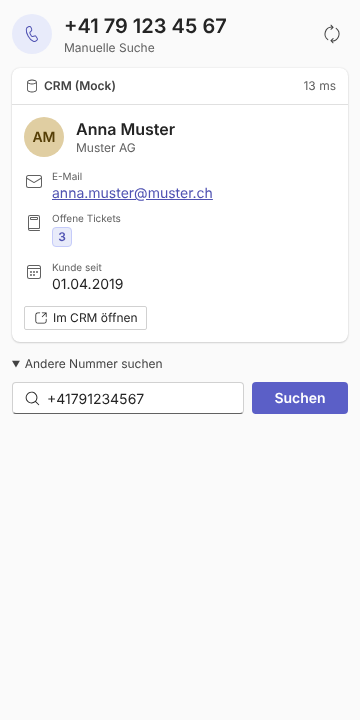
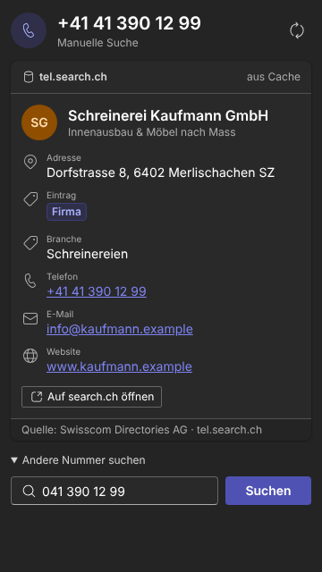

# Caller Info – Teams-App für Anrufer-Informationen

Zeigt während eines **1:1-Anrufs in Microsoft Teams** (PSTN oder Teams-zu-Teams) im Seitenpanel Infos zum Gegenüber an, z.B. aus dem **Schweizer Telefonbuch (tel.search.ch)** oder aus CRM, ERP oder Ticketsystem.

**Kein Server nötig:** Die App besteht nur aus statischen Dateien (HTML, CSS, JS, `config.json`) und fragt die Quellen **direkt aus dem Teams-Client** ab. Hosten kannst du sie z.B. auf GitHub Pages.

| Im Anruf | tel.search.ch (Dark Mode) |
|---|---|
|  |  |

## Wie es funktioniert

```
Teams-Client (1:1-Anruf)
┌─────────────────────────────────────────────┐
│ Seitenpanel "Anrufer" (dist/caller.html)    │      tel.search.ch API
│  1. getMeetingDetailsVerbose() → Nummer     │ ───▶ (CORS erlaubt)
│  2. config.json laden                       │
│  3. Quellen direkt per fetch() abfragen     │ ───▶ eigene APIs / CRM
│  4. Ergebnis anzeigen, im Browser cachen    │      (müssen CORS erlauben)
└─────────────────────────────────────────────┘
```

- Die App ist ein Personal Tab mit Kontext `meetingSidePanel`. In 1:1-Anrufen liefert `meeting.getMeetingDetailsVerbose()` die Nummer bzw. E-Mail des Gegenübers. Ausserhalb eines Anrufs kann man manuell suchen.
- Quellen werden parallel abgefragt. **Fallback-Quellen** wie tel.search.ch kommen nur zum Zug, wenn keine andere Quelle etwas findet.
- Ergebnisse werden pro Nummer im **localStorage** des jeweiligen Teams-Clients zwischengespeichert (tel.search.ch: 24 h).

## Schnellstart

```bash
npm install
cp .env.example .env        # Werte eintragen (siehe unten)
npm run build               # → dist/
npm run package:app         # → appPackage/build/callerinfo.zip
```

1. Den Inhalt von `dist/` statisch per HTTPS hosten (siehe [Hosting](#hosting)).
2. `appPackage/build/callerinfo.zip` im **Teams Admin Center → Teams-Apps → Apps verwalten → Hochladen** hochladen. Genau diese Datei, nicht neu zippen.
3. Die App in einer **Setup-Richtlinie unter «Anrufserweiterungen» (Calling extensions)** anheften und den Benutzer:innen zuweisen. Ohne diesen Schritt erscheint sie nicht im Anruf.

### Was in die `.env` gehört

| Variable | Wofür |
|---|---|
| `PUBLIC_URL` | Adresse, unter der `dist/` gehostet ist, z.B. `https://flawas.github.io/teams-callerinfo` |
| `CLIENT_ID` | Application (Client) ID einer Entra-App-Registrierung (siehe unten) |
| `TEAMS_APP_ID` | Feste GUID der Teams-App. Einmal erzeugen (`node -e "console.log(crypto.randomUUID())"`) und nie mehr ändern |
| `SEARCHCH_*` | tel.search.ch ein-/ausschalten, Key, Cache, Fallback usw. |
| `DEFAULT_COUNTRY_CODE` | Ländervorwahl für nationale Nummern (Standard `41`) |

### Entra-App-Registrierung (nur die ID)

Teams verlangt für die Anruf-Berechtigung (RSC `OnlineMeeting.ReadBasic.Chat`, `OnlineMeetingParticipant.Read.Chat`) eine Client-ID im Manifest (`webApplicationInfo.id`). Die App ruft selbst keine Microsoft-API auf. Die Registrierung braucht deshalb **keine Secrets, Berechtigungen, Rollen oder Redirect-URIs**.

```powershell
./scripts/New-CallerInfoAppRegistration.ps1 -TenantId <tenant-id>
```

Alternativ legst du im Entra-Portal unter *App-Registrierungen → Neue Registrierung* nur den Namen an und kopierst die Anwendungs-ID.

## Hosting

Jedes statische HTTPS-Hosting funktioniert, solange Teams die Seite einbetten darf.

**GitHub Pages (empfohlen):** Der Workflow `.github/workflows/pages.yml` baut bei jedem Push auf `main` und veröffentlicht `dist/`.
1. Repo auf GitHub pushen, dann unter *Settings → Pages → Source* **GitHub Actions** wählen.
2. Optional unter *Settings → Secrets and variables → Actions* die `SEARCHCH_*`-Variablen bzw. das Secret `SEARCHCH_API_KEY` setzen. Ohne Angaben gelten die Standardwerte: search.ch an, ohne Key.
3. Die URL lautet dann `https://<user>.github.io/<repo>`. Die trägst du als `PUBLIC_URL` ein und baust das App-Paket lokal mit `npm run package:app`.

Ebenso möglich: Cloudflare Pages, Azure Static Web Apps (Free) oder ein beliebiger Webspace. Einfach den Ordner `dist/` hochladen.

## Datenquellen

### tel.search.ch (Telefonbuch Schweiz)

Wird über die `.env` aktiviert und ist standardmässig eingeschaltet:

| Variable | Standard | Bedeutung |
|---|---|---|
| `SEARCHCH_ENABLED` | `true` | Quelle aktiv |
| `SEARCHCH_API_KEY` | leer | Optional, [beantragen](https://search.ch/tel/api/getkey). Ohne Key nur Name, Adresse und Link, mit Key zusätzlich Privat/Firma, Branche, E-Mail, Website, Mobile und Fax |
| `SEARCHCH_FALLBACK_ONLY` | `true` | Nur abfragen, wenn keine andere Quelle getroffen hat |
| `SEARCHCH_CACHE_HOURS` | `24` | Ergebnisse pro Nummer im Browser zwischenspeichern |
| `SEARCHCH_MAX_MATCHES` | `3` | Max. Einträge (API-Maximum 20) |
| `SEARCHCH_PRIVAT` / `SEARCHCH_FIRMA` | `true` | Privat- bzw. Firmeneinträge einbeziehen |
| `SEARCHCH_LANG` | `de` | Sprache der Branchenbezeichnungen (`de`, `fr`, `it`, `en`) |

- Abgefragt werden nur Nummern mit **+41/+423**. Ausländische Nummern und reine E-Mail-Anrufe lösen keine Anfrage aus.
- Die vorgeschriebene **Quellenangabe «Swisscom Directories AG»** steht automatisch unter jedem Treffer (Bedingungen Ziff. 4.2).
- Schlägt search.ch bei null Treffern eine *ähnliche* Nummer vor, wird das ignoriert, damit nie eine falsche Person angezeigt wird.

> ⚠️ **API-Key und Kontingent ohne Server**
>
> - **Der Key ist öffentlich.** Er steht in `config.json`, die jeder lesen kann, der die App-URL kennt (bei GitHub Pages: das ganze Internet). Laut [Nutzungsbedingungen](https://search.ch/tel/api/terms) darf der Key nicht an Dritte weitergegeben werden. Verstösse kosten bis CHF 50'000. **Empfehlung:** ohne Key betreiben, oder nur auf einem Hosting mit Zugriffsschutz.
> - **Kein zentrales Monatslimit.** Das Kontingent von 1000 Abfragen pro Monat und Key teilen sich alle Benutzer:innen. Ohne Server gibt es keinen gemeinsamen Zähler, Fallback-Modus und 24-h-Cache pro Client senken den Verbrauch aber stark.

### Weitere Quellen (`sources.json`)

Eigene APIs, CRM, ERP usw. trägst du in `sources.json` ein (Vorlage: `sources.example.json`). Pro Quelle:

| Feld | Bedeutung |
|---|---|
| `id`, `name` | Kennung und Anzeigename |
| `url` | URL-Vorlage mit Platzhaltern, z.B. `https://crm.example.ch/api?phone={phoneE164}` |
| `method`, `body` | `GET` (Standard) oder `POST` mit Body-Vorlage |
| `auth` | `none`, `apiKey` (`headerName`, `value`), `bearer` (`token`), `basic` (`username`, `password`) |
| `headers` | Zusätzliche Header `[{ "name": …, "value": … }]` |
| `responseFormat` | `mapped` (beliebiges JSON + `mapping`) oder `standard` (siehe unten) |
| `mapping` | `resultPath`, `titlePath`, `subtitlePath`, `fields: [{label, path, type}]`, `linkTemplate` (`{{pfad}}`), `linkLabel` |
| `fallbackOnly`, `cacheMinutes`, `timeoutMs`, `maxMatches`, `enabled` | Ausführung |

**Voraussetzungen für Browser-Abfragen:**
- Der Endpunkt muss **CORS** erlauben (`Access-Control-Allow-Origin` mit deiner `PUBLIC_URL`-Origin oder `*`). Sonst meldet das Panel «Nicht erreichbar (Netzwerk oder CORS …)».
- **Zugangsdaten sind öffentlich**, genau wie beim search.ch-Key. Für geschützte Systeme braucht es deshalb eine eigene, CORS-fähige API mit eigener Absicherung, z.B. eine Azure Function mit Entra-Anmeldung.

**Platzhalter:** `{phoneE164}`/`{phone}` (`+41791234567`), `{phoneDigits}` (`41791234567`), `{phoneNational}` (`0791234567`), `{phoneRaw}`, `{email}`, `{userUpn}`, `{userName}`. In der URL werden die Werte URL-kodiert, im Body JSON-escaped.

**Standardformat** (für eigene APIs, dann ist kein Mapping nötig):

```json
{
  "matches": [
    {
      "title": "Muster AG",
      "subtitle": "Kunde seit 2019 · Luzern",
      "url": "https://crm.example.ch/kunden/4711",
      "urlLabel": "Im CRM öffnen",
      "fields": [
        { "label": "Offene Tickets", "value": "3", "type": "badge" },
        { "label": "E-Mail", "value": "anna@muster.ch", "type": "email" }
      ]
    }
  ]
}
```

Feldtypen: `text`, `link`, `email`, `phone`, `date`, `badge`. **404, 204 oder eine leere Liste** gelten als «kein Treffer».

## Lokal testen

```bash
npm run mock      # Mock-CRM + tel.search.ch-Nachbau auf http://localhost:4000 (mit CORS)
npm run dev       # App unter http://localhost:3978/caller.html, baut bei Änderungen neu
```

Für den Mock in der `.env` `SEARCHCH_API_URL=http://localhost:4000/tel/api/` und `SEARCHCH_API_KEY=testkey` setzen. Testnummern: `041 390 12 34`, `041 390 12 99`, `079 111 22 33`. Ausserhalb von Teams zeigt das Panel die manuelle Suche.

## Design

Die Oberfläche folgt dem [Teams-App-Designsystem](https://learn.microsoft.com/microsoftteams/platform/concepts/design/design-teams-app-fundamentals) (Fluent 2): [Fluent UI Web Components v3](https://github.com/microsoft/fluentui/tree/master/packages/web-components), die Teams-Themes (hell, dunkel, hoher Kontrast; wechseln automatisch mit Teams), Fluent-Tokens für Farben, Abstände, Typografie, Radien und Schatten sowie [Fluent System Icons](https://github.com/microsoft/fluentui-system-icons).

## Einschränkungen

- Funktioniert nur im **Desktop- und Web-Client**, nicht in Teams Mobile, und nur in **1:1-Anrufen**, nicht in Meetings.
- `getMeetingDetailsVerbose()` ist in TeamsJS als *beta* markiert. Klappt die Erkennung nicht, zeigt das Panel unter **«Anrufdaten von Teams»** das rohe Objekt zur Fehlersuche.
- Bei **ausgehenden** Anrufen liefert Teams je nach Client nur die eigene Identität. Dann bleibt die manuelle Suche.
- Anrufe über **Call Queues / Auto Attendants** sind nicht getestet.

## Fehlersuche

| Symptom | Ursache / Lösung |
|---|---|
| Upload: `ManifestFileNotFound` | Falsches ZIP. Genau `appPackage/build/callerinfo.zip` hochladen |
| App erscheint nicht im Anruf | Nicht unter *Anrufserweiterungen* angeheftet, Richtlinie noch nicht aktiv (kann Stunden dauern) oder Mobile-Client |
| «config.json konnte nicht geladen werden» | `dist/` nicht vollständig hochgeladen oder `PUBLIC_URL` zeigt auf den falschen Pfad |
| «Gegenstelle nicht erkannt» | RSC-Berechtigungen nicht erteilt. Unter «Anrufdaten von Teams» prüfen, was Teams liefert |
| Quelle: «Nicht erreichbar (Netzwerk oder CORS …)» | Endpunkt erlaubt keine Browser-Anfragen von deiner Origin, ist offline oder hat ein ungültiges Zertifikat |
| tel.search.ch: «API-Key is invalid or blocked» | Key falsch oder gesperrt, ggf. Kontingent überschritten |

## Projektstruktur

```
src/web/        Panel (TeamsJS + Fluent): caller.ts, common.ts, fluent.ts
src/lookup/     Abfrage-Engine im Browser: engine.ts (Fallback, Cache), searchch.ts, http.ts, phone.ts
src/shared/     Schema der Konfiguration (zod), Hilfsfunktionen
public/         caller.html, styles.css
scripts/        build.ts, package-app.mjs, mock-crm.mjs, New-CallerInfoAppRegistration.ps1
appPackage/     Manifest-Vorlage (v1.20) und Icons
.github/        GitHub-Pages-Workflow
```

| Befehl | |
|---|---|
| `npm run build` | `dist/` bauen (inkl. `config.json`) |
| `npm run dev` | Lokal ausliefern und beobachten |
| `npm run typecheck` | TypeScript prüfen |
| `npm run package:app` | Teams-App-Paket erzeugen |
